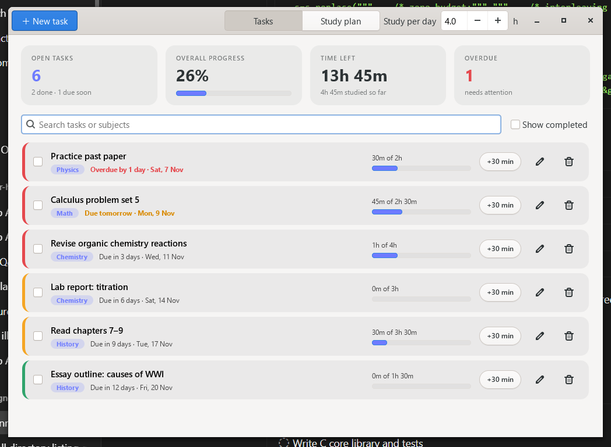
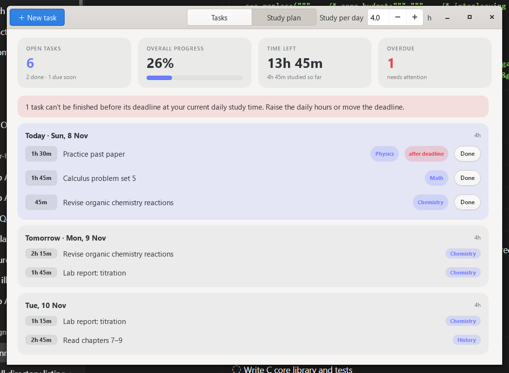

# Study Planner

A desktop study planner with a **GTK 4** interface and a **pure C core**.
Add tasks with a deadline, priority and time estimate; the planner ranks them by
urgency and builds a day-by-day study schedule that fits your daily study time.

| Tasks | Study plan |
| --- | --- |
|  |  |

## Features

- **Tasks** with subject, priority, deadline and estimated effort
- **Urgency ranking** – overdue and near-deadline, high-priority work floats to the top
- **Automatic study plan** – earliest-deadline-first scheduling across days, honouring your
  daily study budget, with subjects interleaved when that does not risk a deadline
- **Deadline warnings** – tells you when work cannot fit before its deadline at your current pace
- **Progress tracking** – log time with one click (`+30 min`, or `Done` on a planned session);
  tasks auto-complete when the estimate is reached
- **Dashboard** – open tasks, overall progress, time left, overdue count
- Search, show/hide completed, edit and delete
- Data saved automatically to a small text file

## Architecture

```
core/planner.[ch]   All logic: tasks, dates, ranking, stats, scheduler, save/load (C11, no GUI)
ui/main.c           GTK 4 front-end: windows, dialogs, widgets (presentation only)
ui/style.h          Application CSS
tests/test_core.c   Unit tests for the core (no GTK needed)
```

The UI never computes anything itself – it calls the C core and renders the result.
The core has no dependency besides the C standard library, so it can be reused from a CLI,
tests or another front-end.

### Core API at a glance

```c
Planner *p = planner_new();
planner_add(p, "Calculus set 5", "Math", PRIORITY_HIGH, date_parse("2026-12-01"), 150, NULL);
planner_set_daily_minutes(p, 180);

Schedule *s = schedule_build(p, date_today(), 0);   // study plan
PlannerStats st = planner_stats(p, date_today());   // dashboard numbers

planner_save(p, "planner.dat");
schedule_free(s);
planner_free(p);
```

Dates are plain day numbers (days since 1970‑01‑01), so scheduling is immune to time zone
and DST quirks.

### How scheduling works

1. Open tasks are sorted by deadline (earliest first), then priority.
2. Each day, every task first gets up to 50 min so subjects are interleaved; any remaining
   daily capacity is then spent in deadline order.
3. Strict earliest-deadline-first is also computed, and the interleaved plan is only used
   if it misses no more deadlines than the strict one – so variety never costs a deadline.
4. Sessions after a task's deadline are flagged and the UI warns you.

## Build

You need a C11 compiler, `make`, `pkg-config` and the GTK 4 development files.

### Windows (MSYS2)

```bash
# in an MSYS2 UCRT64 shell
pacman -S --needed mingw-w64-ucrt-x86_64-gcc mingw-w64-ucrt-x86_64-gtk4 \
                   mingw-w64-ucrt-x86_64-pkgconf mingw-w64-ucrt-x86_64-make
mingw32-make
./build/studyplanner.exe
```

### Debian / Ubuntu

```bash
sudo apt install build-essential pkg-config libgtk-4-dev
make && ./build/studyplanner
```

### Fedora

```bash
sudo dnf install gcc make pkgconf-pkg-config gtk4-devel
make && ./build/studyplanner
```

### macOS (Homebrew)

```bash
brew install gtk4 pkg-config
make && ./build/studyplanner
```

## Usage

```bash
make run                      # build and launch
./build/studyplanner --demo   # try it with sample data (nothing is saved)
./build/studyplanner --data my.dat   # use a specific data file
```

Your tasks are stored in `planner.dat` inside the user data directory
(`%LOCALAPPDATA%\studyplanner` on Windows, `~/.local/share/studyplanner` on Linux), or at the
path in the `STUDYPLANNER_DATA` environment variable. If the file cannot be parsed it is
moved to `planner.dat.corrupt` instead of being overwritten.

## Tests

```bash
make test
```

Covers date maths, task operations and validation, ranking, statistics, scheduling
(capacity, deadlines, infeasible plans, horizon limits) and save/load round trips including
corrupt files.

## License

MIT
